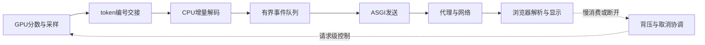

# 第六十八章：流式交付工程——从显存到用户屏幕

上一章，我们已经把模型放进了服务的容量账本，能够区分排队、计算与对外吞吐。现在，我们把镜头移到一个很容易被忽略的位置：GPU已经生成了下一个token，用户却迟迟没有看到文字。监控显示显卡并不忙，接口最终也返回成功，但页面像卡住一样，过一会儿突然出现一大段回答。这种问题不能只靠换更大的显卡解决。

本章沿着一个token的实际交付路径展开：它怎样离开设备侧的计算结果，怎样变成文字与事件，怎样经过服务器和代理，最后被浏览器显示。我们会同时设计一个可运行的离线实验，故意把Unicode字符与事件切得很碎，检查协议是否仍然正确。下一章再接着处理用户断开、慢客户端和资源回收，把一次推理的正常路径与退出路径连成一个完整系统。

下面这张教学图先标出数据与控制的方向，后面逐段展开。

## 一、从显存里出来的，通常不是整个模型

“把显存中的内容推给用户”可以先拆成两个问题：哪些数据需要跨设备边界，哪些数据需要跨网络边界？在普通文本生成里，权重和KV Cache通常留在服务端。GPU计算出候选分数，采样器选出下一token编号，随后只需要把少量编号或已经形成的输出片段交给CPU侧，再经过解码与序列化发送。用户不需要接收整份权重，也不需要接收每层隐藏状态。

假设词表有32768项，每项logit用四字节表示，一条序列一轮的完整分数向量就是\(32768\times4=131072\)字节，即128KiB。如果这一步只需要一个已经在GPU上采好的编号，用八字节整数保存，就只需要八字节。对四条正在解码的序列，完整logits是512KiB，四个编号则是32字节。这里比较的是设备到主机的必要输出量，不包括模型计算本身。

是否能只传编号，要看采样策略和引擎接口。如果应用必须在CPU上执行特殊候选处理，它可能确实需要更多分数；如果GPU端已经完成所需采样，把整个词表搬回CPU就可能是多余开销。优化之前先写清楚消费者到底需要什么，往往比先尝试某个异步选项更有效。我们减少的是无用传输，不是随意删掉算法必须的数据。

还有一个隐蔽成本：CPU读取CUDA张量中的标量，可能等待相关设备计算完成。你看到的一次小小取值，不一定只有八字节传输时间，还可能把此前排队的计算等待计入当前位置。若为批次里的每条请求分别取一次值，也可能制造许多小同步点。适合由引擎统一批量导出的编号，通常应先在同一轮中整理，再减少跨边界次数。

PyTorch的[CUDA语义说明](https://github.com/pytorch/pytorch/blob/v2.8.0/docs/source/notes/cuda.rst)明确区分异步排队与必要同步。本章由此采用一个工程原则：CPU能读到正确结果之前，必须满足依赖关系。把复制标成non-blocking，不等于CPU可以立刻使用尚未完成的数据；使用固定内存、复制流和事件时，也要把等待点与缓冲区生命周期一起设计。

因此，第一张性能图应当把采样、设备到主机交接、解码与发送分别标出来。若直接用一段CPU墙钟包住所有异步调用，可能测到提交速度；若在每一步都做全设备同步，又可能改变原本的并行。需要测设备阶段时采用相应事件，需要测用户等待时使用端到端时间，两份数据回答不同问题。

## 二、token编号怎样变成可以追加的文字

拿到token编号之后，还没有得到可以直接显示的字符。分词器可能把一个中文字符或表情拆成多个底层片段；某些解码规则还会处理空格和相邻片段。把每个token单独解码，再把显示结果拼起来，不一定等于对完整token序列进行正确解码。第二章讨论的字节边界，在流式生成里变成了真实接口问题。

先用UTF-8做一个独立、明确的小例子。表情“🌍”由四个字节组成，十六进制依次为F0、9F、8C、8D。网络第一次可能只交来前两个字节，第二次才交后两个。前两个不是完整字符，正确做法是暂存在增量解码器里，等后面到齐再输出。若每个网络块都独立按UTF-8强行解码，可能抛出错误，或者产生无法恢复的替换字符。

这个例子说明网络字节流的处理，不意味着所有tokenizer都直接提供UTF-8字节片段。实际工程要使用该分词器适合流式输出的解码方式。某些实现会暂存不稳定的后缀，等能够确定后再发布；另一些应用保留完整已生成编号，重新解码后只提交稳定的新部分。接口应当明确发布的是可追加增量，还是允许改写之前内容的快照。

如果采用“完整解码后取新增后缀”，必须检查新文本是否真以旧文本为前缀。若新的规范化结果改写了末尾空格或其他字符，按旧长度截断可能丢字。可选设计包括使用支持稳定增量的解码器，或在协议里显式提供替换区间。不能让前端猜测一次事件究竟是追加还是修正；否则同样一段模型输出，可能在不同客户端呈现不同结果。

本书实验将这两层分开：模拟引擎直接提供合法文字片段，事件再编码为UTF-8；客户端故意一次只接收一个字节，验证增量解析。它确实验证网络碎片不会破坏中文与表情，却没有验证所有BPE分词器的流式解码。实际接入本书模型时，还应把分词器专用解码器加入同样的测试路径。

为了定位问题，可以保留三份计数：模型生成了多少token，解码器发布了多少字符，客户端展示了多少事件。它们不应该被要求始终相等，因为单位不同，解码器也可能暂存片段；但若生成计数持续增长，发布字符长期不动，就该查看解码缓冲。如果服务器事件正常、页面仍不动，问题已经更靠近传输或渲染侧。

## 三、流式协议要先定义清楚事件

文本流不能只是一串“有新内容了”的通知。一个实用的协议至少需要区分开始、内容增量、结束与错误，并给事件一个在本次运行内可比较的序号。本书示例把序号、事件类型和JSON负载编码为SSE事件，事件之间用空行结束。内容增量里的text是文字，complete事件则说明服务端已经走完正常发送路径。

选择SSE，是因为它适合服务端连续向客户端发布事件，文本格式也容易观察。[WHATWG规范](https://html.spec.whatwg.org/multipage/server-sent-events.html)定义了UTF-8事件流和EventSource的重连机制。我们使用其中少量稳定语义，不假设一个自写的小解析器已经实现完整浏览器标准。配套解析器只处理本书生成的单行JSON、LF分隔协议，生产环境应采用经过验证的实现。

事件序号和token位置也要区分。一次事件可以合并多个token，某些事件只有状态而没有文字，所以第十个事件不一定对应第十个token。若一个事件包含编号101到104的几个输出片段，应用可以另外记录token范围，但不应把传输序号同时当成分词位置、数据库记录号和模型采样步数。

重复事件与缺口要有不同处理。如果客户端已经应用序号7，又收到7，可以依据运行标识和序号忽略重复；若直接从7跳到9，就不能假装没有漏字。它应当请求补发、读取快照，或把运行标成需要恢复。这个策略能让至少一次投递变成幂等的显示效果，但不代表整个分布式系统已经获得无需条件的端到端恰好一次语义。

原生EventSource适合基于URL建立的订阅，也会维护Last-Event-ID。若应用通过POST提交复杂请求，再用fetch读取响应体，就要自己组织取消、解析和重连流程，不能期待EventSource替另一个API自动完成。另一种清晰设计是先创建运行，获得run_id，再订阅该运行的事件；重连只恢复订阅，不重新创建一次推理。

还要分别记录“事件已保存”“事件已交给服务器”“浏览器已处理”。服务器send返回，不意味着用户已经读到或看到了文本。若业务确实需要确认客户端应用到哪个位置，可以让客户端报告最后应用序号，但这种确认也不等于人类理解了内容。把完成条件定义清楚，才能避免日志写着交付成功，用户却只收到半段答案。

## 四、首字延迟要沿着整条链路记账

做一份教学延迟账：请求排队20毫秒，分词8毫秒，prefill用300毫秒，采样2毫秒，设备结果交接0.2毫秒，文本解码0.3毫秒，应用队列与发送1毫秒，代理缓冲额外40毫秒，浏览器等下一次显示约16毫秒。先加20与8得到28，再加300得到328，加2得到330，后面依次到330.2、330.5、331.5、371.5，最终约387.5毫秒。

这是一组明确假设下的算例，不是本书实测吞吐。它说明，GPU阶段之外仍然可能有几十毫秒可优化。若代理缓冲变成两秒，用户首字时间会立刻由约0.39秒变成约2.35秒，而模型本身完全没变。遇到“后台已经生成、前台迟迟不显示”，首先需要把这份账按真实链路测出来。

HTTP首字节也不一定是模型首token。服务器可以很早发送响应头或心跳，网络监控因此显示连接已经有数据，用户却还没有看到回答。至少要区分请求开始、排队结束、首token生成、首文字事件发出与首内容显示。若只优化一个容易取得的时间戳，可能改善报表却没有改善体验。

本地进程内耗时适合使用单调时钟计算差值，跨机器的绝对时间则需要考虑时钟偏差。浏览器与服务端可以各自记录阶段耗时，再通过trace_id关联；若要精确推断单向网络延迟，需要更谨慎的时间同步设计。不要拿两台机器未经校准的时间戳直接相减，再把负数延迟解释成系统很快。

对于连续输出，平均每秒token也会掩盖停顿。一段回答前五秒很快、后面停十秒，最后的平均速度仍可能不算差。可以记录内容事件之间的间隔分布，以及解码器、发送器和客户端各自的最长等待。若服务端生成间隔稳定而客户端成团到达，优先检查中间缓冲；若两边同时停顿，再回到推理与调度。

一次故障排查不必同时改动所有层。先在模型侧发布可追踪的递增序号，再在服务器发送前记录同一序号，最后在浏览器接收与显示时记录它。只要不把敏感正文写进所有日志，这组轻量时间线就能告诉我们，等待到底发生在生成之前、交付之间，还是渲染之后。

## 五、逐token发送与合并发送怎样取舍

每产生一个token就立刻发一个事件，容易理解，也能降低某些情况下的等待。但每个事件都有JSON字段、协议行、调度和传输开销。如果一台服务每秒输出三十个token，每个事件连同字段约一百二十字节，单连接就是每秒三千六百字节；一万个连接合计每秒三千六百万字节，约36MB，还没有计入TLS等开销。

这个量级不一定是瓶颈，但说明不能只按最终中文正文大小估算交付成本。更常见的改进是小量合并，例如积累若干token或到达一个很短的时间上限就发送。首个可显示片段可以优先发出，后续按批次发布，兼顾首字响应与事件开销。批次策略应通过端到端测量选择，而不是固定认为每个token都值得一次前端更新。

假设模型每秒三十个token，相邻token平均约33.3毫秒。若必须凑齐四个才发送，第一个要等后三个，约增加100毫秒。若另设50毫秒到期就发送，便可以限制这种合并等待，但前提是定时器真的独立运行。若程序只在下一个token到来时检查是否超时，而模型中途停顿，所谓50毫秒上限就没有被真正执行。

应用队列必须有容量上限。假设最多保留32个事件，每个事件上限16KiB，每个连接最坏约占\(32\times16=512\)KiB。五百个这样的连接合计256000KiB，除以1024得到250MiB。Python对象、传输缓冲与其他副本还在这笔账之外，所以数量上限与字节上限最好都明确。

有界队列满了，说明某个消费者没有跟上。等待、短暂暂停、取消该请求或转为持久后台任务，都是可以定义的策略；悄悄丢掉文本增量通常不可接受，因为之后的回答会缺字。队列限制的是局部内存，只有把超时与上游控制接起来，才可能阻止一个永远慢的用户长期占用计算资源，下一章会专门完成这条路径。

还要知道队列外面仍有缓冲。[Uvicorn的写流控说明](https://github.com/Kludex/uvicorn/blob/main/docs/server-behavior.md)解释了高低水位与ASGI发送返回的关系，但应用队列、操作系统、代理和浏览器仍然各自拥有边界。一个队列设为四，并不能证明整条链路最多只缓存四个事件；我们需要为主要缓冲层分别建立可观察的预算。

## 六、代理与浏览器也参与决定体验

一些代理为了提高普通HTTP效率，会合并上游响应。对流式接口，这可能变成“服务端逐段发送，用户整段看到”。需要根据实际部署检查响应缓冲、压缩、超时和中间缓存配置。[NGINX代理模块文档](https://nginx.org/en/docs/http/ngx_http_proxy_module.html)提供了相应控制项；是否关闭某项功能，应在限定的流式路由上测量，而不是随意改变全部站点。

示例响应带上text/event-stream、合适的缓存控制，并使用常见的X-Accel-Buffering提示。但它不能强迫所有CDN和代理都遵从，也不能代替反向代理自身配置。最直接的检查是从服务内网到最终用户入口分别观察同一批事件的到达时间，确认在哪一跳开始被成团释放。

前端收到文字后，若每个字符都触发整页重新布局、重新解析全部Markdown，也可能产生明显卡顿。可以在短时间窗口内合并状态更新，保留原始增量，再按合适节奏刷新显示。六十赫兹屏幕一帧约16.7毫秒，后台每毫秒重画整段回答不一定增加可见信息，却会增加主线程负担。

部分Markdown在尚未结束时结构不完整，例如代码围栏只生成了开头。显示层应容忍未完成片段，并在流结束后执行必要的最终整理。文本输出也不能因为来自模型就绕过转义与内容处理；若把外部内容直接当成可执行HTML，性能优化可能同时引入错误的信任边界。这个接口应按普通外部输入设计。

用户切换页面时，还需要明确界面是停止当前生成，还是只取消这个页面的订阅。一个后台研究任务可以继续运行并保存结果，一次即时聊天则可能选择尽快取消。浏览器对象被回收，不应是后端推理停止的唯一依据。下一章会给这两种生命周期分别建立状态机，而不是把所有断开一律视为相同事件。

## 七、用离线实验检查交付接口

配套的[streaming_lab.py](../配套代码/streaming_lab.py)使用标准库模拟引擎、ASGI传输与客户端，不调用GPU，也没有穿过真实代理。第一个实验把“你好🌍”放入JSON事件，再把整个编码结果切成一个字节一块。增量解码和事件拼接后，文字仍然完整，并且结束事件按顺序解析。它验证了碎片处理，而不是证明真实网络永远可靠。

正常发送实验生成四十个内容事件，客户端收到四十个，最后完成；其余实验故意让连接断开、发送抛错或消费变慢。事件队列限定为四，记录的高水位没有超过四。所有已准入场景结束后，模拟资源计数回到零，释放次数为一。退出部分的细节与为什么要同时测试这些分支，下一章会展开。

这个实验最值得带到真实服务里的，不是模拟token速度，而是可以检查的接口不变量：编号连续或显式恢复，字符不因拆包损坏，队列有界，正常结束事件与错误路径明确，资源所有者能够报告退出。换成真实模型引擎之后，可以保留同一套场景，再增加CUDA事件、代理配置和浏览器自动化测试。

正式性能实验还应分别测首内容延迟、稳态输出间隔、服务端发送等待与客户端显示等待。报告里注明模型、输入输出长度、并发、采样、硬件及代理路径。只写“流式比非流式快”，通常混淆了总完成时间与更早看到部分结果这两种改善；它们都重要，但需要各自的证据。

至此，一次生成已经不再停在显存里的编号，而是沿着明确协议成为用户可见的文字。接下来最关键的问题是：这条链路中的任何一端不再继续时，谁负责通知其他组件，哪些状态需要保存，哪些计算必须停止？把退出路径设计清楚，才算真正完成一次流式交付。

## 一个简单练习

模型每秒生成四十个token，客户端只来得及处理每秒十个。假设最初队列为空，容量为九十个token，生成和消费速度都暂时恒定，请计算队列大约多久填满。再把方案改成“达到四个token或50毫秒就发送”，说明为什么定时器不能只等下一次token到来才检查。

提示：先算每秒净增加多少，再用容量除以这个差。对于第二问，可以设想模型发出一个token后停顿两秒：如果没有独立的截止时间等待，那个token会被留在缓冲里。完成标准是能区分模型速度、传输批次与客户端消费速度，并指出等待发生在哪一层。
