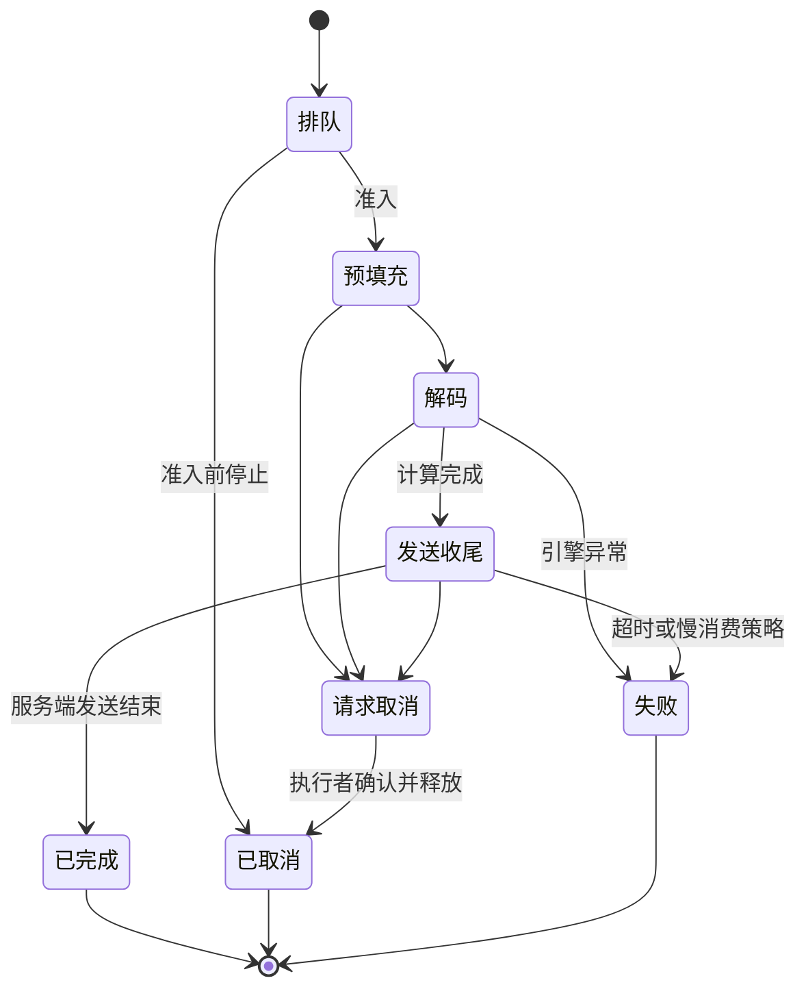

# 第六十九章：断开、取消与背压——让推理资源及时回收

上一章，我们已经把GPU输出连接到用户屏幕，区分了采样、解码、应用队列、服务器发送和前端显示。现在故意让这条链路断掉：用户关掉页面，网络突然切换，代理超时，或者客户端只是慢得几乎不再消费。屏幕上看起来只是少了一个连接，服务端却可能仍在计算、保存KV、占着并发名额。

如果只把正常完成写成一条漂亮流程，退出问题会在并发增加后集中出现。本章为每次推理建立明确的资源所有者与终态，再把取消从HTTP层传到调度器。我们继续使用上一章的离线实验，观察连接断开与发送失败怎样触发清理；同时明确，CPU模拟通过不等于真实GPU内核已经被验证能立即停止。

## 一、先决定断开到底表示什么

用户断开连接，并不天然等于取消任务。即时聊天常希望尽快停止，避免为没人接收的回答继续付出成本；一项已经授权的长时间报告任务，则可能应该在后台完成，用户回来后读取结果。两种产品语义都合理，但必须在创建运行时就定义清楚，而不是由某次网络错误临时决定。

可以把任务与订阅看成两个对象。任务有run_id、状态和资源预算，订阅只是某个客户端正在接收事件。取消订阅可以不取消任务，取消任务则应影响所有相关执行。这样，后台研究任务不会因为移动网络短暂中断就丢失，聊天请求也不会因为服务器忘记传播断开而悄悄跑到最大输出长度。

用户点击“停止”最好对应一个明确的取消命令，服务端验证这个用户是否拥有该运行，再记录取消意图。关闭连接只能作为另一种信号，因为服务器未必立即观察到远端离开。保持连接的心跳与写入错误能够辅助发现问题，但不能承诺网络异常会在某个固定毫秒内被所有组件同时识别。

即便取消已经收到，也需要区分“取消请求已接受”与“资源已经回收”。前者是控制面事实，后者是执行面事实。页面可以立即显示正在停止，服务端则继续等待引擎确认，最终记录取消完成或清理异常。如果这两个时刻混成一个状态，资源还没退出时就可能被重复分配。

因此，本章讨论的是一种明确策略：交互式推理在连接断开后请求取消；持久任务只断开订阅，继续受总时限与预算约束。实际应用可以选择其他策略，但同一个运行不能在不同组件里拥有互相矛盾的解释。把产品语义先固定，技术层才能知道该停止哪一层。

## 二、用状态机处理取消与完成的竞赛

一个请求可以先处于排队，再进入预填充、解码和发送收尾。取消意图可能在任意阶段到达：尚未准入时，应移除排队项；解码中，应停止后续调度；模型已经结束但事件仍在发送时，则主要处理交付与保留结果。将这些阶段区分，有助于避免把所有情况都粗暴地归为一个异常。

终态至少要能区分正常完成、已取消与失败，但终态只应由一个协调者提交一次。设想最后一个token完成的同时，断开监听也醒来：如果两个协程各自写数据库，一个写完成，一个写取消，最终结果可能取决于偶然的写入顺序。应当通过事务条件、版本比较或明确的单一所有者，使终态转换具有确定规则。

规则不一定只有一种。例如，可以规定引擎结果已提交后保留计算完成状态，另外记录订阅未交付完；也可以把一次交互的完成定义为服务端发送循环成功结束。关键是不要把计算状态、订阅状态和用户阅读状态挤进同一个布尔值。后面讨论Agent时，工具已执行但界面没收到结果，也会遇到相同问题。

取消命令本身需要幂等。同一页面可能发出停止请求，又因重试发第二次；断开监听和发送失败也可能同时触发清理。重复命令应该返回同一运行的现有结果，不能让资源引用计数连续减两次，更不能把另一位用户刚复用的槽位一并清掉。资源所有权应绑定稳定运行标识与必要的代次，而不是只记一个容易复用的数组下标。

排队阶段取消值得单独测试。若任务还没有取得GPU槽位，就不应该为了“执行清理流程”先把它准入，再立刻释放。正确的边界是尚未获取的资源无需归还，已经获取的资源必须由所有者归还。配套实验专门让断开发生在准入之前，确认没有创建模拟引擎任务。

下面是交互式请求的一种状态示意。持久任务的订阅状态应另行保存，不直接套用“断开即取消”的策略。

## 三、把连接信号传到实际执行者

对于ASGI应用，一条路径是监听http.disconnect，另一条是处理发送时出现的关闭错误。[ASGI HTTP规范](https://asgi.readthedocs.io/en/latest/specs/www.html)说明，发送错误可能先于断开事件到达，旧实现的错误行为也可能不同。因此，只写一个断开轮询，却不处理send异常，仍然会漏掉重要退出分支。

通常让一个接收协程负责读取断开通知，另一个发送协程负责交付，外层协调者等待其中一个完成。请求体应先按接口规则读完，避免两个协程同时竞争同一个接收通道。若发送正常完成，停止断开监听；若连接先断开，停止发送，并向推理引擎提交取消。退出时还要等待子任务真正结束，不能仅仅丢掉引用。

协程取消是协作式信号，不是终止任何计算的万能按钮。一个任务在等待可取消操作时通常能及时退出，但阻塞的同步调用、外部线程与独立GPU进程可能有自己的生命周期。把CPU协程标成取消，不代表已经向后台推理引擎提交了停止请求。引擎适配层应当暴露按request_id取消的明确接口。

例如，当前[vLLM AsyncLLM接口](https://docs.vllm.ai/en/latest/api/vllm/v1/engine/async_llm/)包含请求级abort，文档展示了输出处理与引擎核心两侧的转发。实际项目要核对所装版本与确认语义，不应把一个版本的函数签名当成永远稳定的标准。本书自己的实验接口则显式等待模拟引擎任务退出，再检查资源计数。

清理代码还必须覆盖应用自身被取消的情况，例如服务器关闭或上层超时。不要用过宽的异常处理把取消悄悄吞掉，让外层以为请求正常完成；也不要在一个等待结束的生成器旁边，由另一个协程随意重复关闭它。由一个协调者管理子任务，其他组件只提交意图，会更容易推理。

若清理本身失败，必须保留可观察状态并进入恢复流程。强行把运行标成“已释放”只会让错误从请求日志转移到资源池。某些服务会暂时隔离有疑问的槽位，交给健康检查或进程级恢复；采用哪种方式取决于引擎能力，但都需要区分失败原因，而不是无限重试同一个取消动作。

## 四、GPU资源何时才真的可以归还

取消通常意味着不再为该请求调度新的生成步骤，已经在执行的设备工作则需要按引擎支持的边界完成或退出。若某个KV块仍被在途内核读取，不能因为HTTP断开就立刻把它交给另一请求写入。安全回收要遵守设备完成事件与内存所有权，而不是只看网络状态。

用本书的MHA模型算一笔KV账。每token需要键和值两份，每份有24层、12个头、每头64维，每个数两字节。先算\(12\times64=768\)，再算\(24\times768=18432\)，两份变成36864个数，乘两字节得到73728字节，即72KiB。这里不含对齐、块元数据和其他运行状态。

若已经缓存2048个token，单请求这部分为\(73728\times2048=150994944\)字节，除以1048576，得到144MiB。假设一百个这样的请求已经无人接收，却都没有释放，相当于还占着14400MiB，即约14.06GiB。实际引擎可能按块分配、预留或共享前缀，因此这是一份便于理解的原始张量账，不能替代真实池统计。

共享前缀进一步要求引用计数。两个请求读取同一份不可变前缀，取消其中一个只能撤销它的引用，不能把另一个仍在使用的块释放。还要把前缀缓存保留策略与请求私有KV区分：请求结束后私有引用清零，某些可复用前缀可能按缓存策略继续占用，不能仅凭显存没有马上下降就认定泄漏。

PyTorch的[empty_cache说明](https://github.com/pytorch/pytorch/blob/v2.8.0/torch/cuda/memory.py)针对未占用的缓存分配。它不会替你删除活跃张量，也不能代替推理引擎解除请求对KV的所有权。每次用户断开就做全设备同步并清缓存，可能影响其他正在运行的请求，却仍然没有修复真正遗漏的引用。

因此，监控应同时看活跃请求、引擎占用块、框架已分配内存与保留内存。取消后的期望结果应由资源模型定义，例如该request_id不再被调度、私有块引用归零、并发名额归还。只用nvidia-smi上的一个总数判断退出是否正确，容易把正常缓存与真实泄漏混在一起。

## 五、背压需要贯穿队列与调度

上一章已经计算，若每秒产生四十个token，用户只处理十个，队列净增加三十个。容量九十个，理论上三秒填满。把队列容量扩大到九百，只是把问题推迟到三十秒，不会让消费速度变快。如果有许多连接同时如此，内存与GPU名额都会在一段时间后成为瓶颈。

有界队列满时，可以先等待一个明确的短时限。若消费者恢复，继续发送；若持续无法推进，就按照产品策略取消交互式运行，或把结果保存到持久任务系统。不要在共享的全局解码循环里等待某个用户的网络写入，否则一个慢客户端可能拖住同批其他人的输出。引擎应维持请求级状态与独立交付通道。

有些引擎支持请求级暂停或抢占，但暂停不一定等于释放KV，恢复也可能需要额外计算。若采用这种策略，需要测量暂停请求的缓存占用与公平性，而不是把“没有继续生成”理解成“已经不耗资源”。对不支持这种控制的引擎，更简单的策略可能是取消并按需要重新创建任务，明确付出重算成本。

准入限制也应包含预计输出与排队预算。服务已经过载时，让更多请求无限排队，只会让取消越来越晚，用户重试又进一步扩大到达量。可以设置队列长度、等待时限与每租户并发限制，对超额请求返回明确可重试结果。重试应有退避与幂等标识，避免客户端在一次断开后同时创建许多份同样的推理。

还可以用Little定律理解回收延迟。假设每秒有十个请求进入“用户已走、后台未停”的状态，平均还要五秒才清掉，那么稳态平均会积累\(10\times5=50\)个这种请求。若把平均清理等待降到一秒，相同到达量下约为十个。这里应用的是稳定流量下的平均关系，不是任何瞬时洪峰的保证。

这个结果提醒我们，取消延迟是容量指标的一部分。模型每token快了一点，却让无人请求多跑几十秒，整体吞吐可能反而更差。上线前应把大量客户端中途退出作为压力场景，观察取消到引擎停止、取消到资源归还的分布，而不只测试所有用户都耐心等到结束的理想流量。

## 六、重连、重试与后台任务不能混为一谈

如果选择持久后台任务，事件应该先按运行顺序保存，再由订阅者读取。连接中断后，客户端带着最后应用序号回来，服务端补发仍在保留期内的事件，或提供一个完整快照。这恢复的是可见输出，不自动恢复一个已经丢失的KV缓存、采样随机状态或未保存的工具执行。

若进程重启导致推理状态丢失，可以明确失败、重算，或采用引擎支持的检查点机制。重新从提示开始生成，未必得到完全相同的后续，即使使用相同种子，也要考虑运行版本与并行数值行为。不能把新的生成文字接在旧事件序号后，伪装成同一次连续运行；需要显式版本或替换快照语义。

对于已经进入工具执行的Agent任务，重试的风险更大。支付、发消息、修改记录这类外部动作，不能因为结果回传丢了就直接再做一次。后面的harness专章会使用幂等键与执行回执解释这个问题。文本补发、模型重算和外部动作重试，虽然都可能发生在断线后，实际承担不同的正确性责任。

短暂断开保留多久，也是一项资源策略。如果聊天服务允许十秒重连，可以选择短期保留事件而取消GPU计算，或者短期保留计算继续输出到有界持久存储。两者用户体验与成本不同，需要事先测量。不要让一个没有期限的“也许用户会回来”，变成永远不释放运行的理由。

事件恢复还必须验证访问范围。知道run_id或Last-Event-ID，不等于自动获得该运行的读取权限。每次订阅都应按用户和租户重新授权，再检查序号是否在可用范围。一个性能优化接口若允许跨用户续读缓存，就把内容交付问题变成了数据越界问题。

## 七、逐个破坏正常路径，观察实验结果

[配套离线实验](../配套代码/streaming_lab.py)实现一个有四格队列的模拟引擎，再用虚拟ASGI发送与接收函数制造故障。正常场景发送四十个增量，得到完成状态；断开场景在客户端接收第三个增量后触发http.disconnect，协调者取消引擎，最后模拟块数回到零，释放计数为一。

发送失败场景不等待断开通知，而是在第三次内容发送前抛出OSError。实验记录客户端只收到两个增量，引擎已经生成三个；这一个差距说明，生成完成与交付完成不是同一个计数。随后同样请求取消并清理，没有为了凑齐计数而继续向已关闭连接写数据。

慢消费者场景让发送端每次等待较久，生产者把四格队列填满，再触发入队时限。实验以slow_consumer失败结束，不静默丢弃中间文本，也没有无限扩容。另一场景设置更短的发送时限，验证send_timeout分支同样能够收尾。两者都失败，但原因被分别记录，有助于定位拥堵所在层。

实验还重复调用了一次清理，确认不会多释放一遍；在准入前断开的场景里，则没有创建引擎任务。这些检查围绕资源与生命周期不变量，不试图用模拟速度冒充GPU性能。真实环境仍需验证引擎取消确认、在途内核、共享前缀、代理断开传播与浏览器行为。

程序为方便阅读，由一个协调者提交终态，并在finally路径等待子任务与引擎退出。这是一套能够理解的应用层最小实现，不是面向多进程崩溃的完整恢复系统。生产服务若要求协调者进程突然消失后仍能清理，需要把所有权、心跳、租约和过期运行扫描交给独立管理层。

## 八、部署时把退出也当成可验收能力

滚动发布时，应先停止新准入，再让已有请求在约定时限内完成或取消，最后确认执行资源归还。若直接杀掉HTTP进程，而独立推理进程仍保留旧request_id，可能出现看不见的孤儿运行。应用关闭、工作节点退出与整个引擎重启，需要各自的收尾约定。

跨进程的取消消息也可能丢失或重复。管理层可以按租约发现不再有有效拥有者的请求，但必须防止迟到的旧进程继续提交结果。带代次的运行标识与执行令牌能够帮助拒绝过期写入。这里的思想与普通分布式任务系统相同，模型并不会让这些基础问题消失。

一次验收应覆盖正常结束、用户停止、网络断开、发送异常、消费者过慢、排队超时与服务关闭，并检查相应资源曲线。无需把每种错误都变成用户面前的大段诊断；用户需要清楚的状态与可采取的动作，工程日志则保留足够定位信息。健康时保持简洁，异常时能够解释，才是可靠的交互服务。

两章工程实战到这里形成闭环：文字能从模型稳定地到达用户，不再需要时又能让计算与资源退出。下一章，我们把关注点从传输协议转回模型输入，把提示写成可以检查的任务接口；随后进入工具、检索与Agent时，这套运行和取消边界会继续被使用。

## 一个简单练习

本书MHA配置每token原始KV占72KiB。假设一个已取消请求还多生成四十个token，请算它额外增加多少KiB，再换算成MiB。另设每秒五个请求被取消，平均三秒后才回收，估算稳态平均还有多少个请求等待回收。

提示：第一题先算\(72\times40\)，再除以1024；第二题用到达率乘平均等待时间。最后补一句说明：为什么“显存保留量没有立刻下降”不能单独证明泄漏？完成标准是区分请求私有资源、可复用缓存与框架保留内存，并知道取消接受与回收完成是两个时间点。
