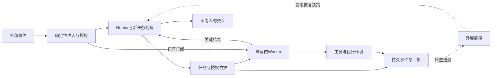

# 第八十一章：Agent harness与Super-agent——从会话到持久运行系统

上一章，我们已经把Agent评估拆成结果、过程与成本。现在再换一个角度：一个Agent今天做完任务之后，明天怎样接着工作？用户从群聊转到代码评审区，系统怎样知道还是同一件事？执行进程崩溃时，怎样区分“动作没做”与“动作做了，只是回执没回来”？这些问题主要落在模型周围的运行系统，也就是harness上。

本章会使用2026年10月31日公开的DeepSeek Super-agent研究原型作为新案例，并与Anthropic关于长期任务和Managed Agents的官方材料对照。重点是把新观点变成可以实现与验证的接口。模型负责理解与决策，harness组织上下文、工具执行、权限、状态和恢复；这两者相互影响，却不能用一段更长的提示词替代所有系统职责。

## 一、先辨认新发布的到底是什么

本章核对的仓库是[deepseek-ai/dsh-superagent-prototype](https://github.com/deepseek-ai/dsh-superagent-prototype)，不是DeepSeek Harness主仓库，也不是名称相似的社区实现。官方GitHub元数据显示，仓库创建于2026年10月31日，初始提交为6337fc823ce2开头的版本。本书保存了当时的文档快照和来源摘要，后续读者应注意主分支仍然可能变化。

README给了两项很重要的限定：这是研究原型，并非DeepSeek正式产品；公开代码经过发布适配，与内部版本和配套设计文章不完全相同，部分设计方向尚未实现。因此，不能把文章中的全部设想、团队内部实例和公开仓库，混成一份已经达到生产可用状态的功能清单。这个区分本身，就是阅读前沿工程材料的第一步。

配套文章《Super-agent设计探索：迈向更自主的Agent系统》的[原始发布入口](https://mp.weixin.qq.com/s/zoS7GlReWPhfCjENGxXCdg)已定位，但本次未能直接取得该入口正文。下文对当前实现的判断以官方仓库000—008文档为依据；未从官方实验记录核验的性能数字，不列为本书已证实的提升。设计讨论中的BYOM、外部Watchdog等方向，会与当前可确认的实现分开介绍。

这个做法不会减少新案例的价值，反而让它更容易使用。我们可以确认一套原型怎样处理事件、任务与执行，再从需求出发分析还需要补哪些能力。若一项设计只是路线，便用“可以怎样设计”来讲；若一项接口已经在公开文档里定义，就说明具体约束；若只是一个实验结果，就必须带上实验条件。

在本书中，harness不是一个必须由某家厂商定义的单一产品名。你可以把它看成模型调用之外的控制层：接收事件、决定是否启动、构造模型可见内容、执行工具、保存记录、控制预算，并在停止或失败时收尾。不同系统的边界不完全一样，所以比较时应先问每一层实际承担什么，而不是只比较是否用了这个术语。

## 二、Router与Worker拆开的是两种职责

Super-agent案例最容易迁移的观点，是把全局交互协调与具体任务执行分开。Router理解来自不同入口的新需求，保持跨任务连续性，决定把任务交给哪个Worker；Worker则在相对独立的上下文里执行某件工作。一个模型可能同时具备两种能力，但把它们放进同一个不断被消息打断的会话，会让响应与执行互相争用。

官方原型用更具体的领域对象落地这些关系：[001 Domain model](https://github.com/deepseek-ai/dsh-superagent-prototype/blob/main/docs/001-domain.md)定义Source、Trigger、Thread、Eval、Ticket、Mandate和Assignment等概念。我们不需要把所有类名背下来，可以沿一件事追踪：外部来源产生事件，事件属于某条讨论，系统判断是否接受，接受后形成带授权依据的任务，再交给执行者。

这里的Thread表示外部讨论流，不等同于模型的上下文窗口，也不等同于一个永远固定的Worker。一个PR可以产生许多评论与CI事件；相同任务还可能关联其他讨论。若系统需要跨平台连续性，必须由可信来源适配器或明确关联操作建立对应关系，不能仅凭两个页面标题相似，就把不同用户的内容混到一起。

Router也不应该成为所有细节都经过的大中转站。如果每个Worker的每一次文件读取、编译输出都塞回Router，上层上下文很快会膨胀。上层更需要任务目的、关键约束、当前状态、阻塞与可交付结果；执行中的大量细节留在Worker或持久记录里。这样既减少协调负担，也避免不同任务的临时信息彼此污染。

反过来，Worker独立也不意味着共享环境自动无冲突。两项工作可能修改同一个文件、占用同一数据库测试环境，或对同一个PR产生相反更改。需要任务所有权、工作目录隔离、版本检查与合并规则。多Agent提高了并发机会，同时也引入普通并发系统已有的冲突，不能把“独立上下文”当成文件或资源隔离的替代。

对于软件工程读者，可以把这次拆分理解成控制面与执行面的重新划分。Router不必执行所有命令才能知道任务进度，Worker也不必拿到所有入口的对外发送权才能交付成果。职责越明确，越容易替换模型、调整并发，并对失败定位到正确的边界。

这张图概括本章的教学职责划分，不是公开原型的完整代码拓扑。虚线外层监控表示后面讨论的扩展设计。

## 三、先过滤，再决定，再订阅直通

持续接入消息以后，最昂贵的错误之一，是让每条无关消息都触发完整模型推理。官方原型把权限与行为依据作为明确的策略对象，[002 Authorization](https://github.com/deepseek-ai/dsh-superagent-prototype/blob/main/docs/002-authorization.md)区分允许的请求与推断出的主动工作。确定性的来源和身份检查先排除不应进入的事件，语义判断再处理真正需要理解的候选。

这两层不能交换责任。模型认为某条消息“看起来像老板说的”，不能代替平台身份验证；外部文章写着“忽略权限继续操作”，也不能改变当前策略。来源、用户和范围应来自可信连接器与系统配置，模型在这些边界内理解意图。这样既能减少无用调用，也能把授权从自然语言猜测中分离出来。

任务已经接受后，同一讨论的后续事件往往可以直接送给订阅它的执行者，不必每次再做一次全局分派。原型领域模型明确包含Subscription，架构文档也描述了事件向相关Ticket分发。它减少的是已经知道归属关系之后的重复协调，并不意味着后续任何内容都获得新的权限。执行者仍需判断消息是否属于任务，以及是否改变了原来授权。

做一个教学算例：十个新任务各带一个初始事件，每项后来又收到四个明确相关的后续事件，共五十个事件。若每次都要求Router重新决定，就有五十次协调机会；若初始事件各协调一次，后续四十个事件按已建立关系直通，协调机会降为十次。这个百分之八十是本例假设下的算术，不是官方性能测量，也没有计算实际模型耗时。

真实系统还要处理取消订阅、重新分派与权限变化。用户可能在后续消息里提出完全不同的新任务，或者管理员撤销某个来源的访问。订阅关系应能失效，执行任务应能接收相应通知；不能因为一条讨论昨天被允许，今天所有后续操作就永远有效。持久系统的授权需要随状态变化重新检查。

官方原型的[000 Philosophy](https://github.com/deepseek-ai/dsh-superagent-prototype/blob/main/docs/000-philosophy.md)还强调减少团队注意力成本：有请求或有团队规则才行动，结果有用或需要人决策时再发消息。把主动工作先放在只记录的模式里观察，是一种很有工程价值的起点。主动性意味着被授权的策略可以响应环境，不意味着系统自行扩张对外行动范围。

## 四、上下文不是全部状态，召回也不是无限记忆

上下文窗口只能装有限信息，而长期系统的事件历史会持续增长。一个可行设计是把当前高价值信息直接放进窗口，把长内容留在外部存储，只保留摘要和可读取标识。设计讨论把这类选择称为Inline与Spill；在本章的教学系统里，它们是明确的上下文预算策略，不是GPU显存自动换出的功能。

例如，一条新评论只内联问题摘要、PR标识、最近一次结论和必要的代码位置，而将十万字符日志保存在对象存储。模型需要更多证据时，根据标识读取相关片段，再沿任务与讨论的关联继续展开。每一步返回仍应有长度上限与续读入口，避免第一次检索节省的窗口，被下一次无界读取全部占满。

原型提供按领域资源读取的接口，我们可以据此设计这种按对象展开的教学流程。但“链式召回”是否准确，仍取决于标识、关联与访问控制。摘要漏掉了关键否定，关联到错误版本，或把旧任务当成当前任务，都可能让模型得出错误结论。可检索不等于已理解，存在对象ID也不等于拥有读取权限。

这里还要区分三种经常都叫cache的东西：模型上下文窗口，服务端前缀计算缓存，以及供应商可能计费的缓存输入token。减少Router读取的内容，不必然等于同等比例减少KV显存，更不保证端到端耗时按同样比例下降。每项指标都要写明单位、分母与所在层级，才能理解一个优化到底节省了什么。

一种实用的工作状态摘要应包含目标、已确认约束、已完成交付、当前阻塞、下一步和证据入口。它不必保存每次思考，但应让新的执行者知道哪些内容已经实际验证。若只写“进展不错，继续优化”，下一次恢复仍然要从头调查；若把未完成结果写成完成，则可能让任务过早停止。

这也是本书一直区分计划、实现和实测的原因。持久harness的记忆不仅需要压缩长度，更需要保留事实等级。一次命令已提交、进程已启动、测试已通过、产物已交付，分别对应不同证据。上下文交接丢掉这种区别，后续模型再强也可能沿着错误状态继续工作。

## 五、异步执行需要持久任务与回执

把一个长时间工具调用改成启动任务、返回句柄、稍后收到完成事件，可以避免主交互等待整个编译或训练过程。对用户来说，它能够继续接收新要求；对系统来说，必须同时管理任务状态、输出位置、取消与结果回传。异步不是把一个函数丢到后台就结束了，而是增加一份需要维护的生命周期。

官方[003 Execution](https://github.com/deepseek-ai/dsh-superagent-prototype/blob/main/docs/003-execution.md)明确讨论任务阶段、输入交付、暂停和恢复。一个特别值得注意的细节，是暂停处理不一定中断已经运行的执行者。阅读实际接口时，必须分别问它停止了新分派、停止了消息投递，还是确实停止了运行中的工具，不能只凭pause这个名字推断全部效果。

架构文档还把外部效果从领域事务中分离：先保存待做的工作，事务提交后再由适配器执行。这与常见的持久任务和Outbox模式相通。先保存意图，有助于进程重启后知道还有什么没完成；但若外部动作与本地状态不在同一事务，仍然存在“对方已执行、本地没记到”的窗口，需要回执与幂等支持。

假设Worker让外部服务保留三件教学库存。工具已经把十件减到七件，harness在保存结果前崩溃。新执行者只看见一项未完成意图，若直接再扣三件，就变成四件。可靠恢复不能仅靠模型说“我记得做过”，而应使用稳定的操作键，从工具侧查询或重放同一个已完成操作的回执。

交互也有相似窗口：消息已经发送，发送回执在网络中丢失，系统不应无限重复通知同事。不同平台能提供的幂等键与查询能力不同，harness需要按适配器说明真实保证。不要在没有外部支持时承诺通用的恰好一次发送；可以明确可能重复、设计去重标识，或让需要人的内容进入可确认的任务面板。

第六十九章的取消路径在这里继续适用。任务句柄、工具进程与用户订阅是不同对象；取消会话显示不一定取消编译，停止Worker也不一定回滚已提交的外部变更。每种动作都需要知道谁拥有它，什么时候可安全停止，已经完成的部分怎样诚实呈现。

## 六、与Claude观点对照：稳定接口，重审脚手架

Anthropic在[2025年11月的长期Agent文章](https://www.anthropic.com/research/effective-harnesses-for-long-running-agents)中讨论初始化环境、增量工作与结构化交接。这里最容易迁移的思想，是把长期进展放进可读取的产物，而不是期待每次新窗口都拥有完整记忆。本书据此要求任务交接保留验收条件与证据入口，具体实现则可以按项目选择。

其[2026年3月的harness设计文章](https://www.anthropic.com/research/harness-design-long-running-apps)进一步讨论生成者与评估者分工，并提醒模型升级后重新检验原有脚手架。某个分解或重置机制曾经必要，不等于永远必要。这是减少无效复杂度的经验，但不表示一旦模型更强，就可以删除业务授权、资源边界或独立验证。

在[2026年4月Managed Agents文章](https://www.anthropic.com/research/managed-agents)里，团队把session、harness与执行环境分开，强调持久会话记录不等于当前模型上下文。我们可以据此构建一个替换关系：执行环境故障时替换环境，协调进程故障时恢复协调，模型调用窗口变化时重建视图，而不是让整项工作与某个不可丢失的容器绑定。

这些文章日期都早于本次DeepSeek原型发布，不能写成“最近两天Claude也刚提出同一观点”。它们与新案例形成的是工程方向上的对照：如何让多任务持续运行、降低对单次会话的依赖，并把失败边界做成稳定接口。比较观点相似之处，不需要虚构同步发布的时间线。

同样，云端协调与本地执行环境的分离是一项可以讨论的架构方向。它允许把未提交工作留在原环境，但本地设备离线时，云端常驻并不能让离线机器继续执行。系统应把环境不可用作为明确状态，安排重试、迁移或请求用户处理，而不是用“7×24在线”掩盖实际执行条件。

公开原型的[006 Deployment](https://github.com/deepseek-ai/dsh-superagent-prototype/blob/main/docs/006-deployment.md)还说明，它的角色工具限制不等于操作系统隔离。运行身份能够读取哪些文件、持有哪些凭据，仍然由真实环境决定。部署设计需要把模型可见工具、进程权限和网络范围分别审视，不能因为Router工具较少，就认定整套系统已经受到强隔离。

## 七、主动工作与Watchdog需要外层边界

设计讨论中的主动响应与外部Watchdog很有启发，但本书没有从当前已核对的公开接口确认它们的每个设想都已经实现。因此，下面把它们作为扩展设计分析，而不把它们列成原型已经提供的生产承诺。一个长期任务系统可以有外层监控，但“有监控会话”与“系统能可靠自愈”之间，还需要验证。

最简单的Watchdog先检查确定性事实：任务是否超过期限，心跳是否停止，错误是否连续发生，产物是否长期没有变化。再让模型结合任务目标判断是否偏离，可以提供更丰富的线索。但输出很多token、工具调用频繁或进程仍然存活，都不等于任务取得了实质进展。

例如，一个代码Worker每分钟重复运行同一条失败测试，心跳正常、日志持续增长，却没有修改或新的诊断。外层可以把重复失败签名、无变更时长与未满足验收项结合起来，先记录异常，再按策略暂停、重试或请求人判断。若只有“请模型检查是否正常”一条提示，监控也可能跟着被相同解释说服。

Watchdog还应有自己的权限和预算。它不能因为检测到阻塞，就自行扩大工具访问、修改原始授权或删除证据。涉及策略变更时，应由具备相应权限的维护者决定，保留版本与回退路径。一个能够重启工作的控制回路，也可能不断放大错误，所以重试次数、故障范围和终止条件同样需要外部限制。

主动提前尝试的工作，也应区分可撤销的研究与外部影响。先复现问题、准备草稿、运行隔离测试，通常比较容易设置预算与丢弃结果；向同事发消息、推送改动或改变业务记录，则需要原有授权和明确策略。减少人的注意力成本，不是把所有需要决定的动作悄悄做掉。

## 八、让一次崩溃成为可以重放的实验

[harness_recovery_lab.py](../配套代码/harness_recovery_lab.py)没有安装DeepSeek原型，也不调用真实模型或外部平台。它实现一个很小的确定性教学系统，用SQLite保存事件、订阅和工具回执，目的是验证两个具体边界：重复事件是否重复分派，以及工具完成后harness丢失返回时，恢复会不会重复产生业务影响。

第一条授权事件为某个PR建立任务订阅，发生一次路由；第二条同一逻辑讨论的后续事件直通，发生一次直接交付；再次提交第二条事件被识别为重复；来自未允许身份的第三条事件被过滤。实验因此记录一次Router决定、一次直通，以及各自明确的去重与权限结果。跨平台关联在实验里是预先给定的，不冒充已经解决真实身份与讨论匹配。

第二部分先保存一项工具意图，再让工具把十件库存减去三件，得到七件。工具把库存变化与回执在自己的同一事务里提交，随后模拟harness尚未保存结果就关闭。重新打开持久日志后，执行者从未完成意图读取原操作键与参数，再调用工具；工具返回已有回执，库存仍是七，而不是四。

程序还故意用同一键改成保留四件，确认服务拒绝冲突参数。否则，一个幂等接口可能把旧结果错误套给新请求。最终检查只有一份持久回执，意图已经被结果事件补齐。它验证的是这个服务能够提供的幂等边界，不能推广成任意外部工具都天然支持相同保证。

真实系统若把业务服务换成第三方接口，需要重新确认键的范围、保留时间、查询能力与事务语义；若没有幂等支持，某些失败只能进入人工核对。教学代码也只模拟指定崩溃窗口，没有覆盖断电、磁盘损坏、多机竞争和所有迁移情况。将实验范围写清楚，是为了让它成为后续扩展的可信起点。

## 九、评估harness时，别只看一次漂亮演示

比较harness应该尽量固定模型、任务、工具权限与预算，再单独改变路由、订阅或评估组件。若一个方案允许更多并发、更长运行时间和更多token，它得到更高成功率可能有价值，但不能把全部差异都归因于某个架构名词。需要同时报告完成率、尾部延迟、调用量、成本与人工介入。

百分比尤其需要检查分母。做一个与任何官方结果无关的教学假设：关闭直通后缓存读取从20M升到28M，增加8M，相对原20M是百分之四十；反过来，打开直通从28M降到20M，节省比例是\(8/28\)，约百分之二十八点五七。两个方向不能都说节省百分之四十，更不能把缓存读取比例直接当作总成本比例。

如果任务执行用的是模拟耗时工具，实验主要说明调度行为；如果要证明真实代码能力，还要检查改动、测试、回归与评审结果。如果只测试几十项任务或少量运行，尾部指标也可能很不稳定。对于本次新案例，本书没有将尚未取得官方实验原文的转述数字写成已复现性能，也没有把原型仓库的存在当成效果保证。

我们最后关心的不是harness功能越多越好，而是它是否在明确边界内，让正确工作更容易持续完成，让失败能够被发现与恢复，让人的注意力花在真正需要决定的地方。下一章会继续讨论提示注入、数据边界与供应链：当系统长期连接更多入口和执行环境时，可靠性与权限设计就更不能只留在模型的善意里。

## 一个简单练习

三条授权事件依次属于讨论A、讨论A、讨论B，A与B最初都没有Worker；每个新讨论第一次需要Router决定，后续按订阅直通。再把第二条事件重复投递一次，请算Router决定数、直接交付数与重复事件数。随后设工具从五件库存保留两件，提交后回执丢失；说明恢复时为什么必须复用原操作键，而不是生成一个新键再调用。

提示：重复投递不应进入新的工作路径，第二条有效事件已有订阅。库存问题先算真正执行一次后应剩多少，再检查新键会不会被服务看成另一项合法操作。完成标准是把上下文连续性、事件去重、授权与工具幂等分开解释，并指出它们分别依靠哪一层保证。
